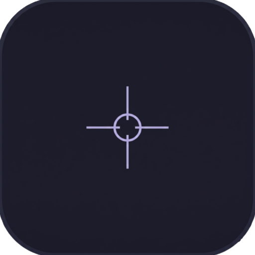
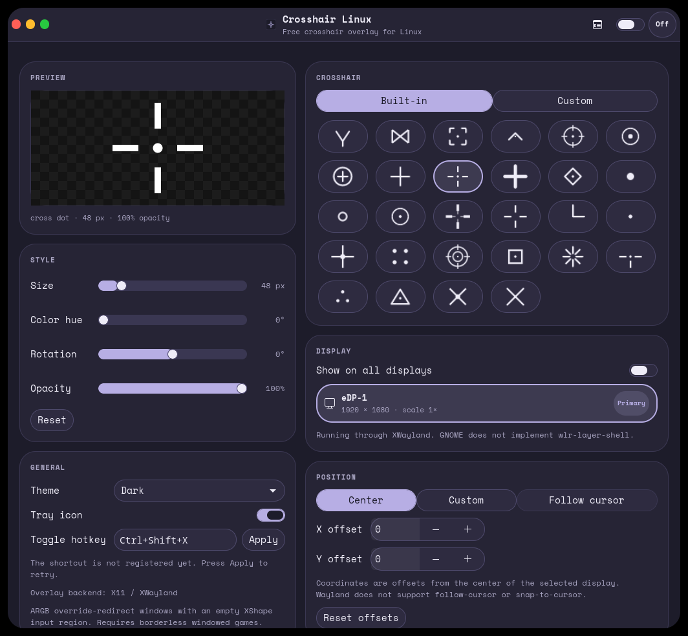

# Crosshair Linux

<p align="center">
  
</p>

<p align="center">
  A minimal, native crosshair overlay for Linux — built with Rust and GTK4.
</p>

<p align="center">
  <a href="LICENSE"></a>
  
  
</p>



Crosshair Linux draws a small, click-through crosshair on top of your games and
desktop. It stays out of the way: no Electron, no Chromium, no always-running
render loop — just a native GTK4 app and a lightweight overlay backend.

This project is a fork of [**Dilates Crosshair**](https://github.com/dilates/crosshair).
The original app is Electron-based; this fork is vibe-coded in Rust with GTK4 for
a much smaller memory and storage footprint, while keeping the settings UI simple:
preview, style, crosshair picker, display, position, and a few general options.

## Features

- Built-in crosshair pack with 28 designs, plus your own SVG/PNG crosshairs
- Built-in designer to create, name, and save custom crosshairs
- Size, color hue, rotation, and opacity controls with a one-click **Reset**
- Center, custom offset, and follow-cursor positioning (follow is X11-only)
- Multi-monitor support, including "show on all displays"
- X11/XWayland and wlr-layer-shell Wayland overlay backends
- System tray icon and a global show/hide hotkey
- Dark, AMOLED dark, and light palettes
- Settings persist automatically; the overlay renders only when something changes

## Install

### Requirements

- Linux with an X11 or Wayland session
- GTK 4.10 or newer at runtime
- For the native Wayland overlay: a compositor that supports `wlr-layer-shell`
  (Sway, Hyprland, KWin, and other wlroots-based compositors).
  GNOME does not, so it uses XWayland automatically.

### Quick install (single command)

Clone the repository, enter it, and run the installer:

```sh
git clone https://github.com/DexytF3/crosshair-linux.git && cd crosshair-linux && ./install.sh
```

### Step by step

```sh
git clone https://github.com/DexytF3/crosshair-linux.git
cd crosshair-linux
./install.sh
```

If no compiled binary exists, `install.sh` builds a release binary for you
(requires Rust and the build dependencies listed below).

The installer places everything under `~/.local`:

| File | Location |
| --- | --- |
| Binary | `~/.local/bin/crosshair-linux` |
| Application shortcut | `~/.local/share/applications/io.github.crosshairlinux.CrosshairLinux.desktop` |
| Icon | `~/.local/share/icons/hicolor/512x512/apps/io.github.crosshairlinux.CrosshairLinux.png` |

After installing, launch **Crosshair Linux** from your application menu, or run:

```sh
crosshair-linux
```

If `~/.local/bin` is not on your `PATH`, use the full path
(`~/.local/bin/crosshair-linux`) or add it to your shell profile.

### System-wide install

```sh
sudo PREFIX=/usr ./install.sh
```

### Uninstall

```sh
./install.sh --uninstall
```

This removes the binary, icon, and application shortcut. Your settings in
`~/.config/crosshair-linux` and custom crosshairs are left untouched. Use
`./install.sh --help` to see all options.

## Usage

- Press <kbd>Ctrl</kbd>+<kbd>Shift</kbd>+<kbd>X</kbd> to show or hide the crosshair.
- Click the tray icon to open settings, middle-click to toggle.
- Closing the settings window hides it; the app keeps running in the background.

The same actions are available from the command line:

| Command | Description |
| --- | --- |
| `crosshair-linux --settings` | Open the settings window (default) |
| `crosshair-linux --toggle` | Show or hide the crosshair |
| `crosshair-linux --show` | Force the crosshair to be visible |
| `crosshair-linux --hide` | Force the crosshair to be hidden |
| `crosshair-linux --quit` | Exit the running instance |
| `crosshair-linux --version` | Print the version |
| `crosshair-linux --help` | Show all options |

Crosshair Linux runs as a single instance per session, so these commands talk to
the app whether it is already running or not.

## Configuration

Settings live in:

```
~/.config/crosshair-linux/config.toml
```

Custom crosshairs (imported files and designer output) live in:

```
~/.local/share/crosshair-linux/crosshairs/
```

Use the **Import…** button in the Crosshair card to copy an SVG or PNG into your
collection, or open the designer to build one from scratch. Everything is saved
automatically.

## Build from source

Build dependencies: Rust 1.85+, GTK 4.10 development headers, and the usual
X11/Wayland development packages.

<details>
<summary>Install build dependencies</summary>

**Debian / Ubuntu**

```sh
sudo apt install build-essential pkg-config libgtk-4-dev libwayland-dev libx11-dev libxrandr-dev
```

**Fedora**

```sh
sudo dnf install gcc pkgconf-pkg-config gtk4-devel wayland-devel libX11-devel libXrandr-devel
```

**Arch Linux**

```sh
sudo pacman -S --needed base-devel gtk4 wayland libx11 libxrandr
```

</details>

Then build and run:

```sh
cargo build --release
./target/release/crosshair-linux --settings
```

## How it works

- **Overlay** — a transparent, always-on-top, click-through surface. On wlroots
  compositors it uses `zwlr_layer_shell_v1`; otherwise it creates an
  override-redirect ARGB window through X11/XWayland.
- **Rendering** — crosshairs are rasterized with `tiny-skia` + `resvg` into a
  shared-memory buffer. Nothing redraws until the style, position, or display
  layout changes.
- **Hotkeys** — X11 uses passive key grabs; Wayland uses the desktop's
  `GlobalShortcuts` portal.
- **Settings** — changes are debounced and saved atomically to TOML.

You can force a backend when needed:

```sh
CROSSHAIR_BACKEND=x11 crosshair-linux
CROSSHAIR_BACKEND=wayland crosshair-linux
```

## Attribution

- Inspired by [**Dilates Crosshair**](https://github.com/dilates/crosshair) (Electron original)
- Fork maintained by **Dexytf3** — <https://github.com/DexytF3>
- Licensed under the MIT License. See [LICENSE](LICENSE).

Enjoy the app. Made with Love.
